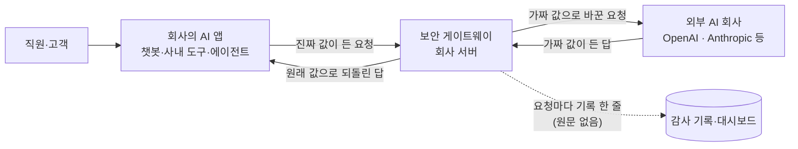
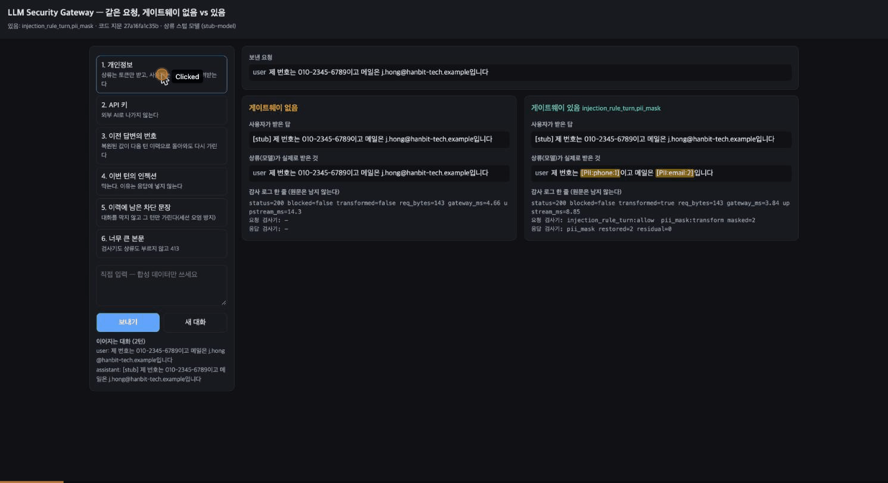
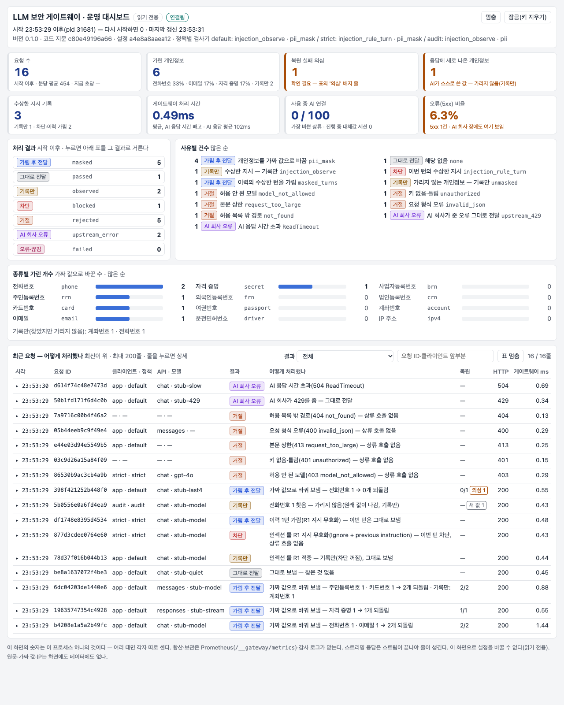

# LLM 보안 게이트웨이

[English](README.en.md) · **공개 데모: <https://llm-security-gateway-demo.fly.dev/>** · [쉽게 읽는 제품 설명서(PDF)](docs/overview/LLM보안게이트웨이_제품설명서.pdf)

**회사의 개인정보가 ChatGPT·Claude 같은 외부 AI로 나가기 전에, 번호를 같은 모양의 가짜 값으로 바꿔 보내고 답이 돌아오면 원래 값으로 되돌려 주는 '관문'입니다.**
회사 서버에 직접 설치해 쓰는(자체 호스팅) 프로그램이고, 이미 쓰고 있는 AI 앱은 주소와 키 두 가지만 바꾸면 됩니다.

---

## 한눈에 보기

직원이 사내 챗봇에 자기 전화번호를 적으면 이렇게 됩니다.

| 단계 | 보이는 글 |
|---|---|
| ① 직원이 쓴 글 | 제 번호는 **010-2345-6789**입니다. 연락 주세요. |
| ② 외부 AI 회사가 받은 글 | 제 번호는 **010-8419-3027**입니다. 연락 주세요. ← 게이트웨이가 바꾼 가짜 번호 |
| ③ AI의 답 | **010-8419-3027**로 연락드리겠습니다. |
| ④ 직원이 받은 답 | **010-2345-6789**로 연락드리겠습니다. ← 게이트웨이가 원래 번호로 되돌림 |
| ⑤ 남는 기록 | 팀 이름·시각·가짜 값 1개 발급·1개 되돌림·처리 시간 — **글 자체는 남기지 않음** |

외부 AI 회사는 진짜 번호를 한 번도 보지 못합니다. 가짜 번호도 진짜처럼 생겨서 AI는 눈치채지 않고 평소처럼 답합니다.

## 왜 필요한가

- 직원과 고객은 AI에 질문하면서 주민번호·전화번호·카드번호·API 키를 무심코 붙여 넣습니다. 그 글은 그대로 회사 밖 AI 회사로 갑니다.
- 단순히 `***`로 지우면 AI가 내용을 이해하지 못해 답이 망가지고, AI가 도구(문자 보내기 등)를 쓸 때 번호가 필요한 일도 할 수 없습니다.
- 그래서 **모양은 그대로 두고 값만 가짜로 바꾸는** 방식을 씁니다. 회사 안에서는 진짜 값으로 일하고, 밖으로는 가짜 값만 나갑니다.

## 어떻게 동작하나



게이트웨이는 요청 하나마다 다음을 합니다.

1. **출입증 확인** — 앱이 낸 게이트웨이 키가 맞는지, 너무 많이 보내지 않는지, 허용된 AI 모델인지 봅니다.
2. **수상한 지시 살피기** — "앞의 지시는 무시하고…" 같은 프롬프트 인젝션 문구를 기록합니다(켜면 차단).
3. **가리기** — 사용자 글뿐 아니라 시스템 안내문·도구 결과·함께 보낸 문서 속 개인정보와 API 키를 같은 모양의 가짜 값으로 바꿉니다.
4. **보내기** — 회사의 AI 회사 계정 키를 붙여 보냅니다. 계정 키는 게이트웨이 한 곳에만 있고 앱에는 주지 않습니다.
5. **되돌리기** — 답에 나온 가짜 값을 원래 값으로 바꿉니다. 글자가 조금씩 흘러나오는 스트리밍 답과 AI의 도구 호출에서도 됩니다.
6. **기록** — 누가·언제·무엇을 몇 개 가렸는지를 원문 없이 한 줄로 남깁니다.

꼭 기억할 성질 세 가지:

- **같은 진짜 값은 언제나 같은 가짜 값**이 됩니다(회사만 가진 비밀 열쇠로 계산). 대화가 이어져도 AI가 헷갈리지 않습니다.
- **원문을 저장하지 않습니다.** 진짜↔가짜 대응은 요청 하나를 처리하는 동안만 메모리에 두고 버립니다.
- **실제 AI로 확인했습니다.** 실제 GPT·Gemini·Claude 모델에서 따라 적기·스트리밍·도구 호출·2턴 대화 60건이 모두 원래 값으로 돌아왔습니다([기록](docs/verification/real_providers_router.md)).

## 무엇을 가리나

| 구분 | 종류 |
|---|---|
| **기본으로 가림** | 주민등록번호 · 외국인등록번호 · 여권번호 · 운전면허번호 · 카드번호 · 전화번호 · 이메일 · API 키·비밀키(OpenAI·Anthropic·AWS·GitHub·Google·Slack 키, JWT, PEM 개인 키) |
| **기본은 기록만** (설정하면 가림) | 사업자등록번호 · 법인등록번호 · 계좌번호 · IP 주소 |
| **팀별로 켜면 가림** | 이름 · 주소 — 별도의 한국어 인식 모델(탐지 사이드카)이 찾고, 10건 중 9건쯤 잡습니다 |

종류마다 정확히 어떤 모양을 잡고 무엇을 놓치는지는 [기술 상세 — 탐지 종류](docs/technical-reference.md#탐지-종류)에 있습니다.

**수상한 지시(프롬프트 인젝션)** 는 기본으로 기록만 합니다. 팀별로 켜는 AI 분류기(가드레일)는 한국어 자료로 다시 가르친 모델로, 봉인해 둔 시험 문항에서 한국어 공격의 97.5%를 잡습니다.
처음 몇 주는 기록만 하다가 실제 오탐(정상 문장을 잘못 의심하는 것)이 받아들일 만하면 차단으로 바꾸는 것을 권합니다.

## 못 하는 것

정직하게 적어 둡니다. 전체 목록은 [기술 상세 — 막지 못하는 것](docs/technical-reference.md#2-막지-못하는-것)에 있습니다.

- 정해진 모양이 없는 정보(병력 같은 서술형 민감정보, 형식 없는 비밀번호)는 찾지 못합니다.
- 이름·주소는 그 기능을 켠 팀에서만, 모델이 잡는 만큼만(약 90%) 가립니다.
- PDF·이미지 파일 속 글자는 보지 않습니다 — 글자로 붙여 넣어야 가립니다.
- 질문의 나머지 글은 그대로 나갑니다. 외부 AI 회사를 쓰지 않는 것과 같은 수준의 보호는 아닙니다.
- 기본 인젝션 규칙은 공격의 일부(공개 평가셋에서 8.7%)만 잡습니다. 막는 용도로는 AI 분류기를 켭니다.

## 바로 해 보기

| 방법 | 필요한 것 | 명령 |
|---|---|---|
| 공개 데모 | 브라우저 | <https://llm-security-gateway-demo.fly.dev/> — 게이트웨이 없음·있음을 나란히 비교 (외부 AI로는 아무것도 나가지 않음) |
| 터미널 데모 | Python 3.12 이상 | `python3 scripts/demo.py` — 여섯 장면을 보여 줌 |
| 브라우저 비교 화면 | Python 3.12 이상 | `python3 web/app.py` |
| 로컬 체험 | Docker | `docker compose -f deploy/compose.yml up --build` |



로컬 체험을 띄웠다면 다른 터미널에서 보내 보고, 외부 AI 대신 띄운 가짜 서버(스텁)가 무엇을 받았는지 확인합니다.

```bash
curl -s http://127.0.0.1:8080/v1/chat/completions -H 'Authorization: Bearer test-key' -H 'Content-Type: application/json' \
  -d '{"model":"stub-model","messages":[{"role":"user","content":"제 번호는 010-2345-6789입니다"}]}'
curl -s http://127.0.0.1:8000/__stub/received     # 상류가 실제로 받은 것 — 가짜 번호
```

운영 대시보드: <http://127.0.0.1:8080/__gateway/dashboard> (관리 키 `local-admin-key`) — 요청마다 무엇을 가리고·막고·거절했는지 보입니다.



## 회사에 설치하기

- **앱 개발자**가 바꾸는 것은 두 가지뿐입니다. AI SDK의 `base_url`을 게이트웨이 주소로, `api_key`를 게이트웨이 키로 바꿉니다.
  OpenAI Chat Completions·Responses, Anthropic Messages 세 가지 API를 스트리밍·도구 호출까지 그대로 지원합니다([API 호환 범위](docs/api-compat.md)).
- **운영자**는 서명된 공개 이미지를 씁니다 — `ghcr.io/hongjinkong/llm-security-gateway`와 탐지 사이드카 `ghcr.io/hongjinkong/llm-security-gateway-detect`(취약점 검사를 통과하고 cosign 서명·SBOM이 붙음).
  쿠버네티스 견본은 [`deploy/k8s/`](deploy/k8s/), 설치 순서·키 교체·로그·지표는 [운영 문서](docs/operations.md)에 있습니다.
- 최소 설정은 환경변수 넷입니다 — 게이트웨이 키 `GATEWAY_CLIENT_KEYS`, 가짜 값을 계산하는 비밀 열쇠 `GATEWAY_SURROGATE_KEY`, AI 회사 주소 `TARGET_URL`, AI 회사 계정 키 `GATEWAY_UPSTREAM_KEY`.
  팀별 규칙(무엇을 가리고 어떤 모델을 허용할지)은 설정 파일로 정합니다 — [설정 문서](docs/configuration.md).
- 권하는 도입 순서: 하루 설치 → 2주 동안 기록만(가리지 않고 무엇이 나가는지 봄) → 가리기로 전환.

## 문서 안내

| 문서 | 누구를 위한 것 |
|---|---|
| [쉽게 읽는 제품 설명서(PDF)](docs/overview/LLM보안게이트웨이_제품설명서.pdf) | 비개발자 — 구조·흐름·시나리오·화면·도입 절차 |
| [서비스 구조와 시나리오(Word)](docs/overview/LLM보안게이트웨이_서비스구조와시나리오.docx) | 처음 보는 사람 — 구조도·요청 흐름도·사용 시나리오 일곱 개, 10쪽 |
| [기술 상세](docs/technical-reference.md) | 개발자 — 탐지 종류의 정확한 꼴, 못 하는 것 전체, 실행·배포 명령, 저장소 구조 |
| [설정](docs/configuration.md) · [운영](docs/operations.md) · [API 호환 범위](docs/api-compat.md) | 운영자·앱 개발자 |
| [보안 백서](docs/security-whitepaper.md) | 보안 담당자 — 데이터 흐름·저장하지 않는 것·키 취급·위협 모델 |
| [법적 위치 메모](docs/legal-position.md) | 법무 — 개인정보 보호법 안에서의 위치(**변호사 검토 전 초안**) |
| [가격·계약 초안](docs/pricing.md) | 도입 검토 — 지원 계약의 구성(**초안**) |
| [`DECISIONS.md`](DECISIONS.md) · [`PLAN.md`](PLAN.md) | 왜 이렇게 만들었는지(결정 기록)와 개발 계획 |

## 현재 상태

0.2.1 — 계획한 개발과 첫 공개 배포까지 끝났고, 실제 회사에서 2주 동안 써 보는 첫 시험(PoC)을 기다리고 있습니다.
연구 단계의 측정 기록은 `research-final` 태그에 있습니다.

## 보안 제보 · 라이선스

취약점은 공개 이슈 대신 비공개로 알려 주세요 — [`SECURITY.md`](SECURITY.md). 라이선스는 [Apache-2.0](LICENSE)입니다.
