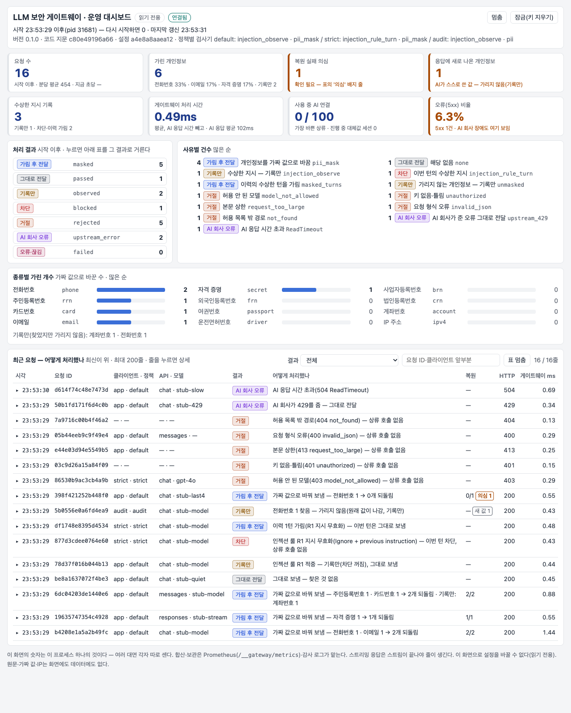

# LLM Security Gateway

[English](README.en.md)

LLM 앱과 AI 공급자 사이에 두는 자체 호스팅 프록시다. **밖으로 나가는 개인정보·자격 증명을 같은 모양의 가짜 값으로 바꿔 보내고 응답에서 되돌리며,
프롬프트 인젝션을 관측(선택하면 차단)하고, 요청마다 감사 한 줄을 남긴다.** OpenAI Chat Completions·Responses, Anthropic Messages
세 API를 스트리밍·도구 호출까지 그대로 통과시킨다. 앱과 모델 코드는 고치지 않는다 — 클라이언트의 `base_url`과 API 키(게이트웨이 키)만 바꾼다.
공급자 키는 게이트웨이 한 곳에만 둔다.

> **상태**: 0.1.0. 상용화 계획([`PLAN.md`](PLAN.md))을 순서대로 진행 중이다. 결정 기록은 [`DECISIONS.md`](DECISIONS.md)(D-108부터).
> 연구 단계의 측정 수치·측정 장치·결정 D-001~D-107은 `research-final` 태그에 있다(`git show research-final:README.md`).

---

## 1. 무엇을 하나

```
클라이언트 (OpenAI SDK · Anthropic SDK · OpenAI 호환 앱 — base_url과 api_key(게이트웨이 키)만 바꾼다)
    │  POST /v1/chat/completions · /v1/responses · /v1/messages   (스트리밍·도구 호출 포함) · GET /v1/models
    ▼
게이트웨이 :8080   그 밖의 경로·메서드는 404(상류에 연결하지 않음) → 클라이언트 키 검증(401) → 레이트리밋(429) → 본문 상한(413) → 파싱(400)
    요청  인젝션 룰 관측(또는 차단) → 모든 역할(system·도구 결과·RAG 문서 포함)의 텍스트와 도구 인자 속 개인정보·자격 증명을 같은 모양의 가짜 값으로 교체
    상류  허용 목록의 헤더만 넘기고 공급자 키를 단다(쿠키·X-Forwarded-*·조직 헤더·게이트웨이 키는 넘기지 않는다)
    응답  가짜 값을 원래 값으로 복원(스트리밍은 조각 경계·채널별, thinking·reasoning은 손대지 않음) · 요청마다 감사 로그 한 줄(원문 없음)
    │
    ▼
상류  OpenAI · Anthropic · OpenAI 호환 서버(로컬 Ollama 등)
```

- **상류는 `010-8419-3027` 같은 가짜 값을 보고 보통의 값으로 다룬다.** 모델이 "가려졌다"고 눈치채지 않고 도구 인자에도 그대로 쓰며,
  사용자는 원래 값을 돌려받는다. 상류 로그에는 가짜 값이 남는다(상류 운영자는 그것이 대체값인지 알 수 없다 — 의도된 선택).
- **원문은 저장하지 않는다.** 가짜 값과 원래 값의 대응은 요청 하나의 메모리에만 있고 응답이 끝나면 버린다. 감사 로그에는 크기와 지문만 남는다.
- **같은 원문은 언제나 같은 가짜 값이 된다.** 가짜 값은 대체값 키(`GATEWAY_SURROGATE_KEY`)로 정해지므로 다음 턴 이력에 다시 와도 바이트가 같다 —
  프롬프트 캐시와 Anthropic thinking 서명이 깨지지 않는다. 실제 Claude API(`claude-haiku-5-5`, 2턴 대화 5개)에서 둘째 턴이 서명 검사 400 없이 캐시를 읽었고,
  요청마다 난수였던 옛 코드는 5개 모두 400이었다([`docs/verification/multiturn_claude.md`](docs/verification/multiturn_claude.md)).
- **인젝션은 기본으로 막지 않는다.** 룰은 두 개(지시 무효화·역할 전환, 한국어·영어 어휘)이고 정상 문장("ignore the instructions in the PDF and summarize")도 걸린다.
  적중은 감사에 남고(`would_block`), 운영자가 `GATEWAY_INJECTION=block`으로 켠다.

바로 보기: `python3 web/app.py`(브라우저 비교 화면) 또는 `python3 scripts/demo.py`(터미널) — Docker·외부 공급자 없이 여섯 장면을 보여 준다(3절).
아래는 웹 화면 기록이다(대체값 도입 전의 GIF라 "상류가 실제로 받은 것"에 가짜 값 대신 `[PII:…]` 토큰이 보인다).


### 탐지 종류

종류 이름은 감사 로그·지표(`kind`)와 `GATEWAY_PII_KINDS`에 쓰는 이름이다. 탐지는 모양만 보고, 문맥어(값 앞뒤 20자)는 가릴지만 정한다 — 응답에서 문맥 없이 돌아온 가짜 값도
같은 모양으로 되찾기 위해서다. 그래서 문맥 없이는 흔한 숫자열과 구별되지 않는 꼴(구분자 없는 10·12자리 등)은 지원하지 않는다.
**감사만** 종류는 탐지해 감사(`unmasked`)에 남기고 그대로 보낸다 — `GATEWAY_PII_DETECT_KINDS`에서 빼면 가린다.
재현율은 가리기로 켰을 때의 합성 코퍼스 값이다(`eval/pii/`, 종류마다 양성 100건, 숫자가 빽빽한 업무 문장 음성 1,200건의 오탐은 전체 3건 0.2%).

| 종류 | 잡는 꼴 | 검증 | 기본 | 가리지 않는 경우·지원하지 않는 꼴 | 재현율 |
|---|---|---|---|---|---|
| 주민등록번호 `rrn` | 앞 6자리 + 뒤 7자리(하이픈·공백·붙임), 성별 1~4 | 실제 날짜, 검증식(등급만 — 2020-10 이후 번호는 검증식이 없다) | 가림 | 검증식이 안 맞고 구분자·문맥어(주민·생년·등록번호…)가 없는 13자리는 감사만. 하이픈 앞뒤 빈칸 | 98 (검증식 통과 55/55) |
| 외국인등록번호 `frn` | 같은 꼴, 성별 5~8 | 실제 날짜, 검증식(등급만) | 가림 | 주민번호와 같다 | 95 (검증식 통과 57/57) |
| 여권 `passport` | M·S·R·O·D + 8자리(구형), + 3자리·대문자·4자리(2021-12 차세대) | — | 가림 | 구형은 '여권·passport'가 가까이 없으면 감사만. 소문자 | 80 (차세대 47/47) |
| 운전면허 `driver` | `11-20-123456-78`(하이픈) | 지역 11~26·28 | 가림 | 구분자 없는 12자리, 지역명 꼴(`서울 07-…`, 2014-07 이전) | 100 |
| 카드 `card` | 13~19자리(하이픈·공백·붙임) | Luhn, 발급사 범위(국내 전용 9 포함) | 가림 | 범위 밖(IMEI·주문번호 등)은 카드 문맥어가 없으면 감사만. 점 구분 | 100 |
| 전화 `phone` | 국내(010·02·031…·070)·괄호 지역번호·`+국가번호` | — | 가림 | 050 안심번호, 영문자에 붙은 번호(`TEL010-…`) | 100 |
| 이메일 `email` | `로컬@도메인` | — | 가림 | — | 100 |
| 자격 증명 `secret` | OpenAI·Anthropic·AWS·GitHub·Google·Slack 키, JWT, PEM 개인 키 | 접두사·형식 | 가림 | 접두사가 없는 키·비밀번호 | 100 |
| 사업자등록번호 `brn` | `123-45-67891`(하이픈) | 검증식 | **감사만** | 구분자 없는 10자리 | 100 |
| 법인등록번호 `crn` | `134511-0012340`(하이픈) | 검증식 | **감사만** | 주민번호 꼴인 번호(`110111-1…`)는 '법인'이 가까이 없으면 주민번호로 가린다 | 89 |
| 계좌번호 `account` | 은행별 하이픈 꼴 14가지(국민·신한·우리·하나·농협·기업·카카오·토스·케이·우체국·SC·새마을) | — | **감사만** | 계좌 문맥어(계좌·입금·송금·은행 이름…)가 없으면 감사만. 구분자 없는·띄어 쓴 계좌 | 64 |
| IPv4 `ipv4` | 공인 주소(사설·예약·멀티캐스트·끝이 0인 주소 제외) | — | **감사만** | '버전·빌드·펌웨어…'가 가까우면 감사만. 문맥어 없는 4묶음 버전 번호는 IP로 오인. IPv6 | 100 |

패턴·검증식은 Presidio 한국 인식기(KR_RRN·KR_FRN·KR_BRN·KR_PASSPORT·KR_DRIVER_LICENSE)와 공개 검증식으로 대조했다(DECISIONS D-117).
가짜 값은 같은 모양이고 검증식이 있는 종류는 검증식을 맞춘다(주민·외국인 번호는 날짜·성별만). 운전면허 지역·사업자 앞 5자리·법인 앞 7자리·계좌 앞 3자리·IP 첫 묶음은 그대로 둔다.

---

## 2. 막지 못하는 것

- **형식이 없는 개인정보·기밀.** 탐지는 1절 '탐지 종류' 표의 열두 종류뿐이다. 이름·주소·IBAN·IPv6·서술형 민감정보는 그대로 나가고, 표의 '지원하지 않는 꼴'
  (구분자 없는 운전면허·사업자·계좌번호, 띄어 쓴 계좌, 소문자 여권, 050 안심번호, 영문자에 붙은 번호, 점으로 구분한 카드 번호 등)도 잡지 못한다.
  전각 숫자·제로폭 문자·대시 변형(–)은 정규화해서 잡고, 가짜 값은 원문 자리에 넣고 원문 그대로 돌려준다.
- **애매한 숫자열은 가리지 않는다.** 구분자 없이 붙여 쓴 13자리 주민·외국인 번호 꼴이 검증식에 맞지 않고 앞뒤 20자 안에 '주민·생년·등록번호' 같은 말이 없으면,
  Luhn은 맞지만 카드 발급사 범위 밖인 숫자열(IMEI·주문번호 등)에 '카드' 같은 말이 없으면, 구형 여권 꼴(글자 + 8자리)에 '여권'이 없으면 감사(`unmasked`)에만 남기고
  그대로 보낸다 — 업무 번호를 지키는 대가로 그 꼴의 진짜 값은 상류로 간다. 표의 머리줄에만 '여권번호'가 있는 표·CSV도 같다.
- **사업자·법인·계좌번호와 IP는 기본으로 보낸다.** 탐지해 감사에 남기지만 가리지 않는다(`GATEWAY_PII_DETECT_KINDS`로 켠다) — 사업체 번호는 공개 의무가 있는 식별자이고,
  계좌 꼴은 은행마다 달라 송장·관리번호와 겹치며, IP는 개발 대화에서 질문의 대상(서버 주소)인 경우가 많다. 고객 접속 로그를 다루면 켠다.
- **비텍스트**(이미지·PDF 원본·오디오·파일 ID로 가리킨 내용)와 텍스트가 아닌 블록, Responses 사용자 정의 도구(`custom_tool_call`·`custom_tool_call_output`),
  도구 정의는 보지 않는다 — 그 안의 개인정보는 그대로 나간다. 가리는 자리는 [`docs/api-compat.md`](docs/api-compat.md)에 API별로 있다.
- **공급자 쪽 도구는 가짜 값을 받는다.** 웹 검색·코드 실행·원격 MCP는 공급자에서 가짜 값으로 돈다 — 값으로 무엇을 찾는 원격 도구는 엉뚱한 기록을 찾는다.
  클라이언트 쪽 도구(function calling)는 된다: 게이트웨이가 인자를 원래 값으로 되돌린 뒤 클라이언트 코드가 도구를 돌린다.
- **사고 과정에는 가짜 값이 보인다.** Anthropic thinking과 Responses reasoning 요약은 상류가 서명한 그대로 돌려주므로(바꾸면 다음 턴이 거절되고, 복원하면 원래 값이
  다음 턴에 thinking에 담겨 상류로 간다) 그 안에서는 가짜 값이 보인다.
- **룰이 모르는 공격.** 인젝션 룰은 정해 둔 한국어·영어 어휘에만 듣는다. 공개 데이터셋으로 만든 평가셋 v1([`eval/injection/`](eval/injection/SOURCES.md), 한국어 공격 1,592건 포함)의
  dev에서 **재현율 8.7%**(한국어 5.9%·영어 16.0%, 역할 헤더 위조 2.9%·난독화 2.9%·문서 속 간접 지시 5.1%), 오탐률 2.7%(일반 업무 문장 0%, 트리거 단어가 든 정상 문장 9.2%)다 —
  차단 도구로 쓸 수준이 아니다. 관측(`would_block`)으로만 쓴다. 분류기·외부 가드레일은 같은 셋으로 잰다(`python3 eval/injection/score.py`).
- **출력 방향.** 모델이 새로 내보낸 개인정보는 사용자에게 그대로 간다 — 가리지 않고 감사 `pii_new`·지표 `gateway_pii_new_total`로 센다
  (그 요청에서 가린 원문·발급한 가짜 값이 아닌 것. detect 모드에서는 사용자가 보낸 값이 되돌아온 것도 센다).
- **대체값 복원 실패는 조용하다.** 모델이 가짜 값을 알아볼 수 없게 바꿔 쓰면(구분자·대소문자 변경은 복원된다) 사용자는 가짜 값을 받는다.
  응답 헤더 `x-gateway-pii: issued=N restored=M`, 감사의 `pii_issued`·`pii_restored`·`pii_suspect`, 지표 `gateway_pii_suspect_total`(남은 가짜 값 + 가짜 값의
  끝 4자리·이메일 로컬파트만 나타난 경우)로 보인다. 가짜 이메일은 예약 도메인(`example.com`·`.net`·`.org`)이라 실제 주소가 되지 않지만,
  **가짜 휴대전화 번호는 실제로 쓰이는 번호일 수 있다** — 국내에는 공식 가상 번호 대역이 없다. 복원에 실패하면 사용자가 제3자의 번호를 받을 수 있다.
- **세 API와 `GET /v1/models` 밖의 공급자 기능**(파일·임베딩·오디오·배치·`count_tokens` 등)은 게이트웨이로 쓸 수 없다(404) — [`docs/api-compat.md`](docs/api-compat.md).
- **요청 간 연결.** 같은 대체값 키 아래 같은 원문은 늘 같은 가짜 값이라, 공급자 로그에서 같은 값을 담은 요청끼리 이어 볼 수 있다. 키를 바꾸면 끊긴다.
  키와 가짜 값이 함께 있으면 전화번호처럼 공간이 작은 값은 되짚을 수 있으므로 키는 공급자 키와 같은 등급으로 보관한다.
- **운영 제약.** 레이트리밋·지표는 워커(프로세스)별이다. 정책은 클라이언트 단위이고, 설정을 바꾸면 재시작해야 한다. Responses API의
  `previous_response_id`처럼 상류에 저장된 대화는 게이트웨이가 볼 수 없고 복원하지 못한다.

---

## 3. 실행

Python 3.12 이상이 필요하다.

```bash
git clone <이 저장소>
cd llm-security-gateway
python3 -m venv .venv
source .venv/bin/activate
pip install -e ".[dev]"
```

테스트와 lint — 가짜 상류를 쓰므로 외부 공급자·Docker가 필요 없다. 테스트 데이터는 전부 합성이다.

```bash
pytest -q
ruff check .
mypy
```

한 명령 데모 — 스텁 상류와 게이트웨이를 임시 포트에 띄우고, 여섯 장면(개인정보·API 키·assistant 이력·이번 턴 차단·이력 가림·413)에서
상류가 받은 것과 사용자가 받은 것을 나란히 보여 준다.

```bash
python3 scripts/demo.py
```

브라우저 비교 화면 — 같은 요청을 게이트웨이 없음·있음에 나란히 보내고, 상류가 실제로 받은 것·사용자가 받은 답·감사 한 줄을 보여 준다.
기본은 스텁 상류이고, 있음 쪽만 실제 공급자로 바꿀 수 있다(`WEB_ON_TARGET=https://api.anthropic.com WEB_ON_MODEL=claude-opus-5-5`,
키는 `ANTHROPIC_API_KEY`). 없음 쪽은 언제나 스텁이고, 실제 공급자 모드에서는 인젝션 프리셋이 꺼진다 — 외부 공급자에 공격 문장을 보내지 않는다.

```bash
python3 web/app.py
```

직접 띄워 보기 (터미널 둘):

```bash
uvicorn tests.stub_target:app --port 8000
```

```bash
GATEWAY_CLIENT_KEYS=demo=demo-key GATEWAY_SURROGATE_KEY="$(python3 -m gateway keygen)" TARGET_URL=http://localhost:8000 \
  uvicorn gateway.main:app --port 8080
```

`.env`(견본 `.env.example`)에 설정을 두었으면 `uvicorn gateway.main:app --port 8080 --env-file .env`로 넘긴다 — 게이트웨이는 `.env`를 스스로 읽지 않는다.

```bash
curl -s http://localhost:8080/v1/chat/completions \
  -H 'Authorization: Bearer demo-key' -H 'Content-Type: application/json' \
  -d '{"model":"stub-model","messages":[{"role":"user","content":"제 번호는 010-2345-6789입니다"}]}'
```

실제 공급자 앞에 두기 — 공급자 키는 게이트웨이 환경변수 한 곳에만 있고, 클라이언트는 게이트웨이 키를 쓴다(`python -m gateway keygen`으로 만든다).

```bash
APP_KEY="$(python3 -m gateway keygen)"; echo "클라이언트 키: $APP_KEY"
GATEWAY_CLIENT_KEYS="app=$APP_KEY" GATEWAY_SURROGATE_KEY="$(python3 -m gateway keygen)" \
  GATEWAY_UPSTREAM_KEY=sk-ant-... TARGET_URL=https://api.anthropic.com uvicorn gateway.main:app --port 8080 --no-access-log
```

클라이언트는 `base_url`을 `http://localhost:8080`(Anthropic SDK) 또는 `http://localhost:8080/v1`(OpenAI SDK)로, `api_key`를 게이트웨이 키로 바꾼다.
공식 SDK로 확인하려면 SDK를 별도 venv에 깔고 그 파이썬을 넘긴다: `python3 scripts/check_openai_sdk.py --sdk-python <openai가 깔린 파이썬>`,
`python3 scripts/check_anthropic_sdk.py --sdk-python <anthropic이 깔린 파이썬>`.

운영에서는 uvicorn 접근 로그를 끈다(`--no-access-log`) — 접근 로그는 쿼리 문자열을 값까지 찍어 감사 로그가 일부러 빼는 값을 남긴다.
요청 기록은 감사 로그가 남긴다.

Docker — 비root(uid 10001)로 돌고, 감사 로그만 stdout(JSONL)으로, 기동·오류 로그는 stderr로 나간다(접근 로그는 꺼져 있다). 워커 수는 `WEB_CONCURRENCY`(기본 1), 프록시 뒤에 두면
신뢰할 프록시 주소를 `FORWARDED_ALLOW_IPS`로 준다(기본 127.0.0.1 — 그 밖에서 온 `X-Forwarded-For`는 무시된다).

```bash
docker build -f gateway/Dockerfile -t llm-security-gateway .
docker run -p 8080:8080 -e GATEWAY_CLIENT_KEYS=... -e GATEWAY_SURROGATE_KEY=... -e GATEWAY_UPSTREAM_KEY=... -e TARGET_URL=... llm-security-gateway
```

로컬 체험(Docker Compose) — 게이트웨이와 스텁 상류를 함께 띄운다. 밖으로 나가는 것이 없고 키는 체험용 고정값이다(127.0.0.1에만 열린다, 운영에 쓰지 않는다).

```bash
docker compose -f deploy/compose.yml up --build
curl -s http://127.0.0.1:8080/v1/chat/completions -H 'Authorization: Bearer test-key' -H 'Content-Type: application/json' \
  -d '{"model":"stub-model","messages":[{"role":"user","content":"제 번호는 010-2345-6789입니다"}]}'
curl -s http://127.0.0.1:8000/__stub/received     # 상류가 실제로 받은 것 — 가짜 번호
```

운영 대시보드 — 관리 키를 둔 게이트웨이의 `/__gateway/dashboard`가 요청마다 가림·차단·거절 결과와 그 사유를 2초마다 보여 준다(읽기 전용).
위 compose는 `http://127.0.0.1:8080/__gateway/dashboard`(관리 키 `local-admin-key`), 시험 트래픽은 `python3 scripts/traffic.py` — [운영 — 대시보드](docs/operations.md#대시보드).



Kubernetes — [`deploy/k8s/`](deploy/k8s/)(kustomize, `kubectl apply -k deploy/k8s`): 레플리카 2·PodDisruptionBudget·readiness·종료 유예(preStop 5초 + 25초)·
Pod Security `restricted`. 설정 파일과 키는 ConfigMap·Secret으로 만들어지고, 바꾸고 apply하면 파드가 롤링 재시작된다.
올리는 순서·키 회전·로그 수집·지표·용량은 [`docs/operations.md`](docs/operations.md).

---

## 4. 설정

환경변수와 (선택) 설정 파일(`GATEWAY_CONFIG`, TOML) 하나로 설정한다. 둘 다 기동할 때 한 번 읽고, 틀린 값·모르는 이름은 기동 실패다(주소는 검사하지 않는다). 모든 항목은 [`docs/configuration.md`](docs/configuration.md).

| 변수 | 뜻 |
|---|---|
| `GATEWAY_CLIENT_KEYS` | 클라이언트 키 `이름=키,…` — 설정 파일 `[[clients]]`(해시)와 함께 하나도 없으면 기동 실패 |
| `GATEWAY_SURROGATE_KEY` | 결정적 대체값 키(32자 이상) — PII `mask`(기본)면 필수. 공급자 키와 같은 등급으로 보관하고, 바꿀 때는 [운영 — 키 회전](docs/operations.md#키-회전)을 따른다 |
| `TARGET_URL` · `GATEWAY_UPSTREAM_KEY` | 상류 주소와 공급자 키. API마다 다른 상류(OpenAI와 Anthropic을 한 게이트웨이로)는 설정 파일 `[upstreams.*]` |
| `GATEWAY_PII` · `GATEWAY_INJECTION` | `mask`·`detect`·`off` / `observe`(기본)·`block`·`off` |
| `GATEWAY_ADMIN_KEY` | `/__gateway/`의 info·metrics·stats·대시보드를 연다. 없으면 모두 404 |
| `GATEWAY_CONFIG` | 클라이언트별 정책(인젝션·PII·허용 모델), API별 상류, 해시로 둔 클라이언트 키 |

경로·헤더·오류 형식·차단 응답의 모양은 [`docs/api-compat.md`](docs/api-compat.md)에 있다.

---

## 5. 구조

```
gateway/    앱(main: create_app·라우팅·관리 엔드포인트) · 설정(settings: 환경변수 → Settings, 검사기 체인) · 상류 중계(relay) ·
            인증(auth) · API 어댑터(api/: chat·anthropic·responses) · 검사기(detectors/) ·
            대체값(surrogate)·볼트(vault)·스트리밍 복원(streaming) · 감사 로그(audit)·지표(metrics)·레이트리밋(ratelimit) ·
            운영 대시보드 화면(dashboard.html)
  data/       injection_corpus.jsonl — 인젝션 룰 회귀 테스트 입력
deploy/     compose.yml(로컬 체험) · k8s/(kustomize — Deployment·Service·PDB, 설정 파일, 비밀 견본)
docs/       configuration(설정) · operations(운영) · api-compat(API 호환 범위) · verification/(실 공급자 확인 기록)
  overview/   쉽게 읽는 제품 설명서(PDF·HTML) — 비개발자용: 구조·요청 흐름·시나리오·화면·도입 절차·한계
web/        데모 웹 — 브라우저 비교 화면
scripts/    터미널 데모 · OpenAI·Anthropic SDK 점검 · 실 공급자 2턴 확인(check_multiturn_claude.py) · 대시보드 시험 트래픽(traffic.py)
tests/      단위·통합 테스트 + 스텁 상류(tests/stub_target.py)
eval/pii/   PII 평가 코퍼스(합성, 양성 1,200·음성 1,200·어려운 사례 40)·점수(score.py)·CI 게이트(tests/test_pii_corpus.py)
eval/injection/   인젝션 평가셋 v1(공개 데이터셋 + 한국어 업무 문장, dev 5,492·봉인 홀드아웃 1,379)·만들기(build.py)·점수(score.py)·출처와 라이선스(SOURCES.md)
eval/benign/all100.jsonl   정상 질문 100문항 — 인젝션 룰 오탐 회귀 테스트 입력
```

---

## 6. 보안 제보

취약점은 공개 이슈 대신 비공개로 알린다 — [`SECURITY.md`](SECURITY.md).

---

## 7. 라이선스

[Apache-2.0](LICENSE).
