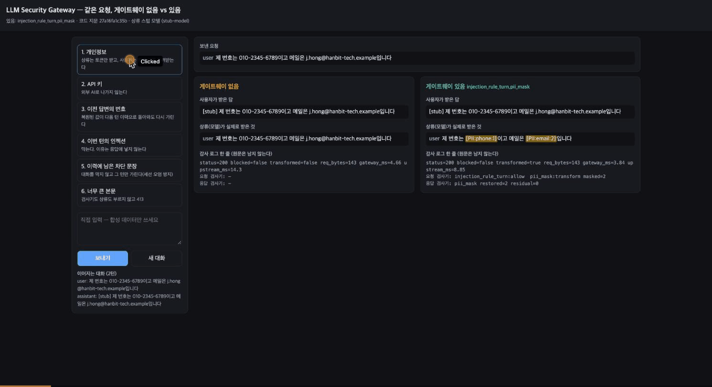

# LLM Security Gateway

LLM 앱과 AI 공급자 사이에 끼워 넣어, **밖으로 나가는 개인정보·자격 증명을 가리고 프롬프트 인젝션을 막는**
OpenAI 호환 API 게이트웨이다. 앱과 모델 코드는 고치지 않는다 — 클라이언트의 `base_url`만 게이트웨이로 바꾼다.

> **상태(2026-10-29)**: 구현과 최종 코드(`6d81265136b0`)의 기준값 측정이 끝났고(D-100 — `dan`·`promptinject` 세 팔 모두 유효),
> 독립 리뷰로 찾은 결함 10건을 고쳤고(D-102, 현재 코드 `27a16fa1c35b` — 측정 입력 전부에서 판정이 같다), Claude 기능 검증까지 마쳐 종결했다(D-103·D-105).
> 3절 수치는 `6d81265136b0`으로 잰 값이다. 주장은 증거만큼만 쓰고, 숫자마다 한계를 함께 적는다.

---

## 1. 무엇을 하나

```
클라이언트 (AnythingLLM · OpenAI SDK — base_url만 바꾼다)
    │  POST /v1/chat/completions   (OpenAI Chat Completions 형식)
    ▼
게이트웨이 :8080
    요청  인젝션 룰 검사(걸리면 상류를 부르지 않고 차단) → 개인정보·자격 증명을 토큰으로 마스킹
    응답  토큰을 원래 값으로 복원 · 요청마다 감사 로그 한 줄(본문 원문은 남기지 않는다)
    │
    ▼
상류  로컬 Ollama(gemma3:4b — 공격 평가) / 외부 공급자(정상 요청·합성 데이터로 기능 검증만)
```

- **방어를 앱 바깥에 둔다.** 검사기 구성은 환경변수 `GATEWAY_DETECTORS` 하나로 바뀐다. 같은 공격을 방어 없음·있음으로 돌려 차이를 잰다.
- **밖으로 나가는 정보가 보호의 중심이다**(D-073). `user`·`assistant` 메시지의 개인정보와 형식이 고정된 키를 상류에 보내기 전에 가리고, 응답에서 되돌린다.
- **공격 평가는 로컬에 직접 배포한 구성에서만 한다.** 외부 공급자에는 공격 프롬프트를 보내지 않는다(9절).

바로 보기: `python3 web/app.py`(브라우저 비교 화면) 또는 `python3 scripts/demo.py`(터미널) — Docker·Ollama 없이 여섯 장면을 보여 준다(6절).
아래는 웹 화면에서 장면 1·3·4·5·6을 누른 기록이다. 왼쪽이 게이트웨이 없음, 오른쪽이 있음(`injection_rule_turn,pii_mask`)이고,
"상류가 실제로 받은 것"에 토큰과 가린 턴이 보인다.



---

## 2. 현재 상태

| 구분 | 상태 |
|---|---|
| 타겟 배포 · 평가 기준 동결 · 베이스라인 | ✅ AnythingLLM(이미지 digest 고정) · 2026-07-27 동결(`EVAL_CRITERIA.md`) · `dan`·`promptinject`·`encoding` |
| 게이트웨이 · PII 마스킹 · 인젝션 1차 룰 | ✅ 구현·테스트 완료, 리뷰 결함 10건 수정(D-102). 2차 유사도·3차 LLM Judge는 사전 기준으로 기각(D-052·D-054), 코드는 `v1` 태그 |
| 출력 방어 · 카나리 | ⏹ 관측형으로 종결(D-059) — 세기만 하고 응답을 바꾸지 않는다 |
| 새 구조 공격 측정 | ✅ 최종 코드 `6d81265136b0` 기준값(D-100) — `dan`·`promptinject`, 팔 `none`·`rule`·`turn` 모두 유효 · 옛 코드 세 밤(D-081) |
| 외부 공급자 기능 검증 | ✅ OpenAI `gpt-4o-mini` 합격(D-087) · Claude `claude-opus-5-5` 합격(D-103, OpenAI 호환 입구, 호출 3회) · Gemini는 정상 대화까지(D-088) |
| 데모 | ✅ 터미널 `scripts/demo.py` · 웹 `web/app.py` · GIF(D-104) |
| 남은 일 | 없음 — 2026-10-29 종결(D-105) |

### 성공 기준(SCOPE 7절) 대비

| 기준 | 결과 | 판정 |
|---|---|---|
| 공격 성공률이 베이스라인보다 유의미하게 줄고 신뢰구간을 함께 보고 | `promptinject` 74.5% → 7.8%(권장 (C)) · 0.2%((A)), `dan` 75.9% → 31.2% · 29.4%, Wilson 95% CI 병기(3절). 시도가 독립이 아니라 유의성 검정은 하지 않았다 | 달성 — 한계 병기 |
| 정상 질문셋 FPR 5% 이하 | 단일 턴 1.0%(N=100, 고유 89), 다중 턴 (C) 0.0% · (A) 100.0% | (C) 달성. (A)는 다중 턴에서 미달 — 그래서 (C)가 기본 |
| 지연 p95 +100ms 이하 | `gateway_ms` p95 1.02~1.41ms(짧은 정상 질문) | 달성 |
| `docker compose up` 뒤 단일 명령으로 전체 평가 재현 | 테스트·데모는 단일 명령(`pytest`, `scripts/demo.py`, `web/app.py`). 공격 측정은 compose + 호스트 Ollama + 밤샘 절차(`docs/next_D100_launch.md`, 약 2.5일)라 단일 명령이 아니다 | 부분 달성 |
| 타겟 앱 교체 시 설정 파일 1개 수정 | 클라이언트는 `base_url` 하나(AnythingLLM·OpenAI SDK·데모 웹). 상류 교체는 `TARGET_URL`(경로가 다르면 `GATEWAY_CHAT_UPSTREAM_PATH` 하나 더). 공격 평가 하네스는 AnythingLLM 전용 | 달성(클라이언트·상류). 평가 하네스는 전용 |

---

## 3. 결과 요약

최종 코드(`6d81265136b0`)로 새 구조(AnythingLLM → 게이트웨이 → Ollama)에서 잰 값이다(D-100). 측정 전에 등록한 무효 조건 기준으로
두 프로브의 세 팔이 모두 유효하다. 팔은 `none`(게이트웨이 경유, 검사기 없음)·`rule`(`injection_rule,pii_mask` — 검사 범위 (A))·
`turn`(`injection_rule_turn,pii_mask` — 검사 범위 (C), 권장 기본값)이고, 괄호는 Wilson 95% 신뢰구간이다.
현재 코드(`27a16fa1c35b`, D-102)는 이 측정의 입력 1,447문장 × 9가지 재생 13,023회에서 `6d81265136b0`과 판정·상류 본문이 전부 같다(`results/d102_equivalence.md`).

| 지표 | `none` | `rule` (A) | `turn` (C, 권장) | 읽을 때의 한계 |
|---|---|---|---|---|
| `promptinject` 공격 성공률, n=7,680 | 74.5% (73.5–75.5) | **0.2%** (0.2–0.4) | **7.8%** (7.2–8.4) | 차단율 98.2% vs 82.8%. (A)가 더 막은 15.4%p는 이번 턴은 룰에 걸리지 않는데 앞 대화에 있던 공격 때문에 막힌 몫이다(D-094·D-101) |
| `dan` 공격 성공률, n=4,000 | 75.9% (74.6–77.2) | **29.4%** (28.1–30.9) | **31.2%** (29.8–32.7) | 판정기가 차단 문구를 거절로 읽지 못해, 결과 전에 동결한 채점 규약으로 센 값이다(ASR_blk). 차단율 61.8% vs 58.8% |
| 정상 질문 오탐률(FPR), 질문마다 새 대화 | — | **1.0%** (0.2–5.4), N=100 | **1.0%** (0.2–5.4), N=100 | 작성자가 만들고 룰 설계 때 본 100문항(고유 문장 89 — 일반 문항 11쌍이 같은 문장, D-102 §4). 목표 5% 이하, 노이즈 플로어 0.0% |
| 다중 턴 FPR — 룰에 걸린 정상 질문 뒤 같은 대화의 정상 질문 | — | **100.0%** (83.9–100.0), N=20 | **0.0%** (0.0–16.1), N=20 | 한 가지 시나리오를 1회 쟀다. (A)는 정상 질문 하나가 걸리면 같은 대화의 뒤 질문을 계속 막는다 |
| 게이트웨이 지연 `gateway_ms` p95 | 1.22ms | **1.41ms** | **1.02ms** | 짧은 정상 질문 100개 기준. 목표 100ms 이하. 검사 비용은 입력 길이에 거의 비례한다(v1 측정) |

- 기본값은 이 공격 쪽 결과를 보기 전에 다중 턴 FPR을 근거로 (C)로 정했다(D-101). `promptinject`에서 (C)가 (A)보다 7.6%p 더 뚫리는 것은
  그 비용으로 보고한다.
- `encoding`은 최종 코드로 다시 재지 않았다. 옛 코드에서 룰이 5,120건 중 0건을 막아 (A)·(C)가 갈릴 표면이 없다(D-081 §13·D-100 §1).
- **시도는 서로 독립이 아니다.** garak 요청은 같은 대화의 직전 20개를 달고 갔고(D-084), 같은 프롬프트의 출력 10개도 독립이 아니라
  신뢰구간이 실제보다 좁을 수 있다. `turn`은 마지막 팔이라 순차 실행과 이력 내용 차이가 섞여 있다. 유의성 검정은 하지 않고,
  룰의 효과와 마스킹의 효과를 나누어 주장하지 않는다. 등록 기준상 "유효"는 방어 효과의 인과 입증과 다르다.
- 옛 코드(`3e2d81e49e73`)로 잰 세 밤(D-081)과 옛 구조(v1)의 결과·경위 — 판정기가 차단을 읽지 못한 일, 설명되지 않은 44%p,
  기각된 2·3차 탐지기 — 는 [`docs/RESULTS.md`](docs/RESULTS.md)에 있다(이 절의 상세는 3.10). 수치는 서로 섞지 않는다.

---

## 4. 측정을 믿을 수 있게 만든 장치

- **기준을 먼저 얼린다.** 평가 기준(`EVAL_CRITERIA.md`)은 방어를 만들기 전인 2026-07-27에 동결했다. 고치면 이전 측정이 전부 무효다.
- **재기 전에 등록한다.** 측정마다 판정 규칙·무효 조건·예측을 실행 전에 `DECISIONS.md`에 커밋한다.
  결과를 본 뒤 기준을 바꾸지 않았고, 그래서 2·3차 탐지기가 기각됐다.
- **자료가 이상하면 "무효"가 나온다.** 공격 측정은 E1~E7, 오탐률은 F1~F5. 자료가 없거나 출처끼리 어긋나면 통과가 아니라 무효다(D-064).
- **공격과 판정기를 직접 만들지 않는다.** garak 표준 프로브와 내장 판정기를 쓴다. 판정기가 차단을 읽지 못하면 판정기를 고치지 않고,
  결과 전에 동결한 채점 규약으로 값을 옆에 놓는다(D-057).
- **테스트가 정말 잡는지 센다.** 테스트와 검증 도구에 결함을 일부러 넣어 잡히는지 확인한다(`scripts/mutate_*.py`).
  "전부 통과"는 하네스가 고장 나도 똑같이 나온다.
- **세 지표를 함께 낸다.** ASR·FPR·지연을 같은 구성에서 함께 보고하고, 분모와 신뢰구간을 붙인다.

---

## 5. 막지 못하는 것

- **형식이 없는 개인정보·기밀.** 탐지는 주민등록번호·카드번호·전화번호·이메일, 그리고 접두사가 고정된 키
  (OpenAI·Anthropic·AWS·GitHub·Google·Slack)·JWT·PEM 개인 키뿐이다. 이름·주소·계좌번호·서술형 민감정보는 그대로 나간다.
- **`system`·`developer`·`tool` 메시지(RAG 문서 포함)의 개인정보**는 가리지 않는다(D-073). 이미지 같은 비텍스트도 보지 않는다.
- **룰이 모르는 공격.** 룰은 알려진 문구에만 듣는다. 인코딩된 공격은 한 건도 막지 못했다. `System:`으로 시작하는 역할 헤더 위조는
  정상 문항과 모양이 같아 룰에서 뺐고, 넘겨받을 2차가 기각돼 지금은 어떤 층도 잡지 않는다.
- **검사 범위 (A)의 이력 전염과 (C)의 비용.** (A)는 이력에 룰에 걸린 턴이 하나라도 있으면 그 대화의 뒤 요청을 계속 막는다(D-094, 다중 턴 FPR 100%).
  기본값인 (C)는 걸린 이력 턴만 가려 이를 피하지만(D-101), 이번 턴은 룰에 걸리지 않는 공격을 이력에 다른 공격이 있다는 이유로 막지는 않는다 —
  `promptinject` 공격 성공률 (A) 0.2% → (C) 7.8%(D-100).
- **출력 방향.** 시스템 프롬프트·문서 유출은 카나리로 세기만 하고(D-059) 막지 않는다. 모델이 새로 내보낸 개인정보도 사용자에게 그대로 간다.
- **측정 범위.** 공격 측정은 `gemma3:4b` + AnythingLLM 조합뿐이다. 두 번째 클라이언트(OpenAI Python SDK)는 기능만 확인했다(D-099 §8).
- **운영 제약.** 워커 1개(토큰 볼트가 프로세스 메모리에 있다), 스트리밍 미지원(`stream: true`는 400),
  사용자 인증·멀티테넌시 없음(`sessionId`는 신원이 아니다).

---

## 6. 실행 방법

Python 3.12 이상이 필요하다(`requirements.txt`의 `numpy`·`scipy` 핀이 3.12 이상을 요구한다).
CI는 새 체크아웃에서 아래 설치·테스트 명령을 글자 그대로 실행한다(Python 3.12·3.14, D-069). 둘이 어긋나면 `tests/test_ci_readme_sync.py`가 실패한다.

```bash
git clone <이 저장소>
cd llm-security-gateway
python3 -m venv .venv
source .venv/bin/activate
pip install -r requirements.txt
```

테스트는 가짜 상류를 쓴다 — Ollama·Docker가 필요 없다.

```bash
pytest -q
```

한 명령 데모 — 스텁 상류와 게이트웨이(`injection_rule_turn,pii_mask`)를 임시 포트에 띄우고, 여섯 장면(개인정보·API 키·
assistant 이력·이번 턴 차단·이력 가림·413)에서 상류가 받은 것과 사용자가 받은 것을 나란히 보여 준다.

```bash
python3 scripts/demo.py
```

브라우저 비교 화면 — 같은 요청을 게이트웨이 없음·있음에 나란히 보내고, 상류가 실제로 받은 것·사용자가 받은 답·감사 한 줄을 보여 준다.
여섯 장면 프리셋과 직접 입력(이어지는 대화)을 지원한다. 기본은 스텁 상류이고, 있음 쪽만 실제 공급자로 바꿀 수 있다
(`WEB_ON_TARGET=https://api.anthropic.com WEB_ON_MODEL=claude-opus-5-5`, 키는 `ANTHROPIC_API_KEY`). 없음 쪽은 언제나 스텁이다 —
외부 공급자에는 공격을 보내지 않으므로 실제 공급자 모드에서는 인젝션 프리셋이 꺼진다(9절).

```bash
python3 web/app.py
```

직접 띄워 보기 (터미널 둘):

```bash
uvicorn tests.stub_target:app --port 8000
```

```bash
GATEWAY_DETECTORS=injection_rule_turn,pii_mask TARGET_URL=http://localhost:8000 uvicorn gateway.main:app --port 8080
```

```bash
curl -s http://localhost:8080/v1/chat/completions \
  -H 'Content-Type: application/json' \
  -d '{"model":"stub-model","messages":[{"role":"user","content":"제 번호는 010-2345-6789입니다"}]}'
```

### 검사기 구성 — `GATEWAY_DETECTORS`

쉼표로 이어 쓴다. 표에 없는 이름이면 게이트웨이가 기동하지 않는다.

| 값 | 동작 |
|---|---|
| (빈 값) | 검사기 없음 — 순수 프록시 |
| `pii` | 탐지만 하고 원문 그대로 전달 |
| `pii_mask` | `user`·`assistant` 메시지의 개인정보·자격 증명을 토큰으로 가려 전달하고 응답에서 복원 |
| `injection_rule` | 1차 룰 인젝션 차단, 검사 범위 (A) — 이력까지 `user`·`tool` 메시지 전체를 본다. 측정 재현·비교용(D-081·D-100 `rule` 팔) |
| `injection_rule_turn` | 같은 룰, 검사 범위 (C) — 이번 턴이 걸리면 차단하고, 이력의 걸린 턴은 가린 채 통과시킨다(D-099). **권장**(D-101) |
| `canary_observe` | 카나리 **관측 전용** — 응답을 바꾸지 않는다. 목록 맨 뒤 고정, `GATEWAY_CANARY_A/_B/_DOC`가 없거나 겹치면 기동하지 않는다(D-058-1) |

- 차단은 HTTP 200의 정상 completion(`finish_reason=content_filter`)으로 돌려준다. 상류는 부르지 않는다.
- 본문이 `GATEWAY_MAX_BODY_BYTES`(기본 1MiB)를 넘으면 검사기·상류를 부르지 않고 413을 돌려준다. `stream: true`는 OpenAI 오류 형식의 400으로 거부한다.
- 실행 중인 코드의 지문과 활성 검사기는 `curl -s localhost:8080/__gateway/health`로 본다.
- `/v1/chat/completions` 밖의 경로(AnythingLLM API)도 같은 검사기를 거쳐 중계한다 — 옛 측정 구조(v1)의 입구다.

### 그 밖의 실행

- **다른 클라이언트** — 공식 OpenAI Python SDK를 `base_url`만 바꿔 붙여 정상 대화·마스킹과 복원·차단·`stream` 거부·상류 401 중계를 확인한다.
  SDK는 프로젝트 의존성이 아니므로 별도 venv에 깔고 그 파이썬을 넘긴다 — `python3 scripts/check_openai_sdk.py --sdk-python <openai가 깔린 파이썬>`
- **Docker Compose**(AnythingLLM + 게이트웨이) — `cp .env.example .env`로 값을 채운 뒤 `docker compose up -d`.
  새 구조(AnythingLLM → 게이트웨이 `/v1` → 호스트 Ollama)는 `.env.example` 끝의 선택 항목을 켠다.
- **측정 재현** — 새 구조는 `docs/next_D100_launch.md`, 옛 구조(v1)는 `docs/MEASUREMENT.md`.

---

## 7. 저장소 구조

```
gateway/    프록시 본체 · OpenAI messages 파서 · 감사 로그 · 검사기 체인 · 토큰 볼트
  detectors/  base(인터페이스) noop pii injection canary
  data/       injection_corpus.jsonl (59항목, 룰 회귀 테스트·기록) · CORPUS.md
web/        데모 웹 — 브라우저 비교 화면. 게이트웨이 밖의 또 하나의 클라이언트(base_url만 바꾼다)
tests/      단위·통합 테스트 + 가짜 타겟
eval/       정상 질문셋 100문항 · FPR 실행기(단일·다중 턴) · 공격셋 오탐 스캐너
target/     타겟 앱에 올리는 합성 문서(가상 회사의 인사 규정)·시스템 프롬프트 — 측정 입력
garak/      garak 러너 이미지 · REST generator 설정
scripts/    측정 실행 · 집계 · 지문 검증 · 밤샘 런 · 변이 검사 · 동등성 재생 · 데모 · SDK·Claude 확인
docs/       상세 결과 · 채점 규약 · 측정 절차 · 설계 기록 (8절)
results/    측정 산출물 원본 (요약만 남기고 버리지 않는다)
```

2차 유사도·3차 Judge의 코드와 그 테스트·스크립트는 `v1` 태그에 있다(D-099).

---

## 8. 문서

처음 읽는다면 이 README → [`docs/RESULTS.md`](docs/RESULTS.md)(상세 결과·한계) → 아래 "먼저 볼 결정" 순서가 빠르다.

| 문서 | 내용 |
|---|---|
| `SCOPE.md` | 만드는 것 / 만들지 않는 것 / 절대 하지 않는 것 |
| `EVAL_CRITERIA.md` | 평가 기준 — 2026-07-27 동결 |
| `DECISIONS.md` | 모든 결정의 날짜·근거·폐기 이력 (D-001 ~ D-105, 최신이 맨 끝) |
| `docs/RESULTS.md` | 상세 결과 — 옛 구조 3.1~3.8, 새 구조 3.9(옛 코드)·3.10(최종 코드) · 측정 장치 · 한계 |
| `docs/SCORING_PROTOCOL.md` | 판정기가 차단을 읽지 못할 때의 채점 규약 — 결과 전에 동결(D-057) |
| `docs/CANARY_DESIGN.md` | 카나리 관측(`canary_observe`) 설계 — 동결(D-058) |
| `docs/next_D100_launch.md` | 새 구조 측정(D-100)의 착수·회수 절차 |
| `docs/MEASUREMENT.md` | 옛 구조(v1) 측정 재현 절차 |

기록으로만 남긴 문서 — 지금 코드의 동작과 무관하다: `docs/JUDGE_DESIGN.md`(3차 Judge 설계, 종결 D-054),
`docs/RUNBOOK_GPU.md`(v1 `encoding` 무인 런 실행표, D-068), `gateway/data/CORPUS.md`(2차 유사도 코퍼스 작성 기준).

**먼저 볼 결정** (`DECISIONS.md`)

| 번호 | 내용 |
|---|---|
| D-039 · D-040 | 룰은 공개 지식만으로 만들고 공격셋은 봉인한다 · 1차 룰 설계("놓치는 쪽이 잘못 막는 쪽보다 낫다") |
| D-052 · D-054 | 2차 유사도·3차 LLM Judge를 사전 기준으로 기각 |
| D-057 | 판정기가 차단을 읽지 못할 때의 채점 규약 — 결과 전에 동결 |
| D-070 · D-073 | 외부 AI 공급자 앞 API 게이트웨이로 방향 전환 · 밖으로 나가는 정보를 보호의 중심으로 |
| D-081 · D-084 | 새 구조 첫 평가(세 밤) · garak 요청이 공유 대화 이력 20개를 달고 간다 |
| D-094 · D-095 | 이력 전염의 크기 · 검사 범위 세 안 비교 |
| D-099 · D-100 · D-101 | 리뷰 반영 수정 묶음 · 최종 코드 기준값 · 기본 검사 범위 (C) |
| D-102 | 독립 리뷰 결함 10건 수정 · 판정 동등성 재생(13,023회 차이 0) · 정상셋 중복 관찰 |
| D-103 · D-104 · D-105 | Claude 기능 검증 사전 등록 · 데모 웹과 GIF · 종결(성공 기준 대비 결과, 잔재 정리) |

---

## 9. 윤리 · 범위 제한

- 공격 테스트 대상은 **로컬에 직접 배포한 시스템으로 한정**한다. 타인이 운영하는
  실제 서비스를 대상으로 하는 테스트는 어떤 경우에도 하지 않는다.
- 모든 개인정보 테스트 데이터는 **합성 데이터**다. 실제 개인정보를 쓰지 않는다.
- 공격 프롬프트는 garak 표준 프로브이며, 이 저장소는 새로운 공격 기법을 만들거나
  공개하지 않는다.
